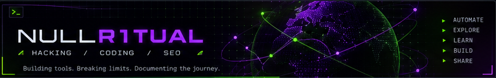

<!--
  NULLR1TUAL // GitHub profile README
  This is a REAL README: only the hero is a full-width graphic.
  All section headings, descriptions, bullet points and project links below are live HTML/text.
  Edit descriptions here; do NOT put these paragraphs inside an image.
  GitHub does not allow custom CSS for the profile sidebar, repo cards or Markdown.
-->

  

<table width="100%">
  <tr>
    <td width="63%" valign="top">
      <h3>👋 Hi there, I'm NullR1tual.</h3>
      

        I build tools, explore security, and document what I learn. Focused on
        automation, cybersecurity, and creating resources that help the community.
        Always exploring new ideas and pushing to build something useful.
      

      

        <code>Cybersecurity</code> &nbsp; <code>Python</code> &nbsp;
        <code>Go</code> &nbsp; <code>Automation</code> &nbsp;
        <code>Documentation</code> &nbsp; <code>SEO</code>
      

    </td>
    <td width="37%" valign="top">
      <h3>🟣 Currently Working On</h3>
      <ul>
        <li>Expanding <strong>DirPhase</strong> with new features</li>
        <li>Building <strong>Noxspan</strong>, a network recon tool</li>
        <li>Creating cybersecurity resources through <strong>0xHTX</strong></li>
        <li>Documenting tools and technical experiments</li>
      </ul>
      <h3>🟢 Tech / Interests</h3>
      

        <code>Python</code> <code>Go</code> <code>Linux</code> 
        <code>Networking</code> <code>OSINT</code> <code>Proxmox</code>
      

    </td>
  </tr>
</table>

<h2>Featured Projects</h2>

<table width="100%">
  <tr>
    <td width="50%" valign="top">
      
      <a href="https://github.com/NullR1tual/DirPhase"><strong>DirPhase ↗</strong></a>
      &nbsp;
      
A Python utility for organizing files into folders by type.

      
<code>Python</code> &nbsp;·&nbsp; <a href="https://github.com/NullR1tual/DirPhase">View repository</a>

    </td>
    <td width="50%" valign="top">
      
      <strong>Noxspan</strong>
      &nbsp;
      
A Go-based network reconnaissance and TCP port-scanning tool.

      
<code>Go</code> &nbsp;·&nbsp; In development

    </td>
  </tr>
  <tr>
    <td width="50%" valign="top">
      
      <strong>Null Spider</strong>
      &nbsp;
      
A desktop SEO crawler and site-analysis tool.

      
<code>Go</code> <code>React</code> &nbsp;·&nbsp; In development

    </td>
    <td width="50%" valign="top">
      
      <a href="https://0xhtx.net"><strong>0xHTX ↗</strong></a>
      &nbsp;
      
An independent Houston hacker zine and technology community.

      
<code>Community</code> &nbsp;·&nbsp; <a href="https://0xhtx.net">Visit 0xHTX.net</a>

    </td>
  </tr>
</table>

  <a href="https://github.com/NullR1tual/DirPhase">DirPhase ↗</a>
  &nbsp; • &nbsp;
  <a href="https://0xhtx.net">0xHTX ↗</a>
  &nbsp; • &nbsp;
  <a href="https://github.com/NullR1tual">GitHub ↗</a>

