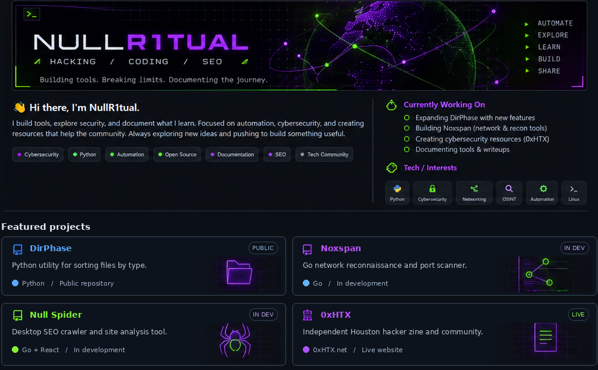

<!--
  NullR1tual — GitHub Profile README
  Faithful visual recreation of the *approved* GitHub preview.
  IMPORTANT: this image affects only the README; it does not change your existing
  avatar, left sidebar, real pinned repositories, or contribution graph.
  Keep README.md and the assets/ folder together in a public repo named NullR1tual.
-->

  

  <a href="https://github.com/NullR1tual/DirPhase">DirPhase ↗</a>
  &nbsp; • &nbsp;
  <a href="https://0xhtx.net">0xHTX ↗</a>
  &nbsp; • &nbsp;
  <a href="https://github.com/NullR1tual">GitHub ↗</a>

